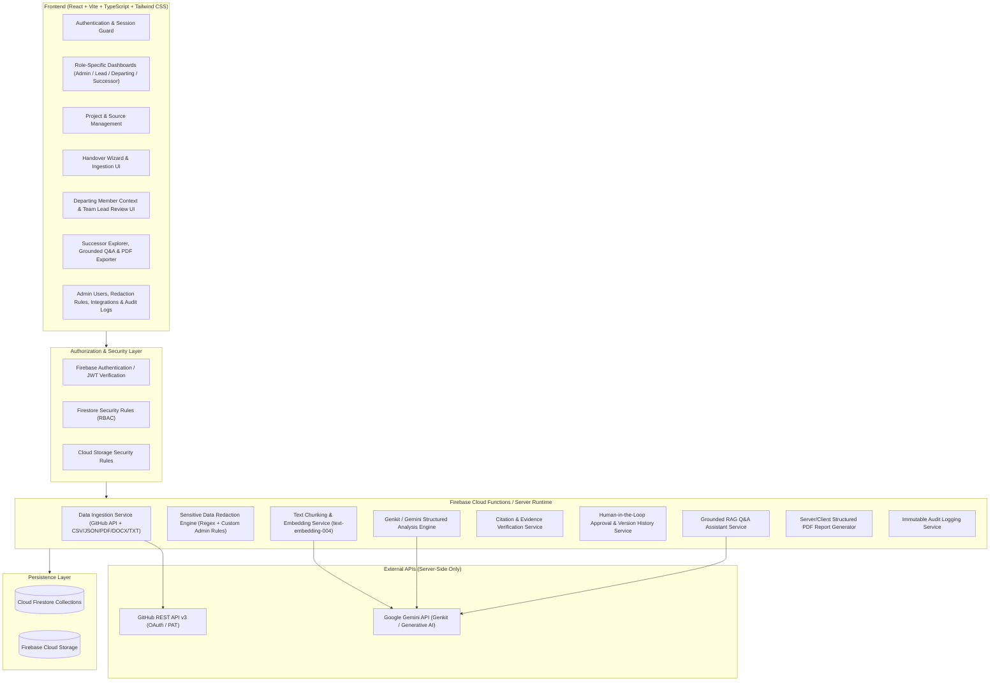

# HandoverIQ — System Architecture & Technical Specification

## 1. Application Architecture

HandoverIQ is a production-oriented, source-backed, leader-verified AI handover management platform built on React, TypeScript, Tailwind CSS, Firebase (Authentication, Cloud Firestore, Cloud Storage, Cloud Functions, Security Rules, Hosting), and Google Gemini API / Firebase Genkit.



### Core Architectural Guarantees
1. **Zero Hallucination / Source-Grounded Claims**: Every generated `reportItem` must link to one or more valid `sourceIds` and include an exact `evidence` excerpt verified against the redacted source text. Any item lacking verifiable source support is automatically flagged/moved to `open_questions` or rejected by the Citation Verification Service. If information for a section is absent in the ingested sources, the system explicitly outputs `"Not found in available sources."`
2. **Pre-AI Redaction Pipeline**: All ingested raw text (from GitHub commits, PRs, issues, review comments, or uploaded CSV, JSON, PDF, DOCX, TXT files) passes through the backend Redaction Service **before** persistence in `sources.redactedText`, **before** text chunking/embedding, and **before** any request to Google Gemini. Original unredacted secrets are never stored in AI prompts or reports.
3. **Defense-in-Depth RBAC**: Every sensitive operation is enforced both in backend Cloud Functions/API middleware and in `firestore.rules` / `storage.rules`. Client-supplied role claims are never trusted.
4. **Mandatory Human Verification**: Reports progress through explicit lifecycle states (`DRAFT` -> `INGESTING` -> `ANALYZED` -> `DEPARTING_REVIEW` -> `LEADER_REVIEW` -> `APPROVED` -> `PUBLISHED`). A report cannot transition to `PUBLISHED` until every required section and report item has been reviewed (`APPROVED` or `REJECTED`, with zero `PENDING` items) by the assigned Team Leader. Successors can only read `PUBLISHED` handovers to which they are explicitly assigned.
5. **Immutable Audit Trail**: Every critical event (`USER_LOGIN`, `USER_REGISTER`, `ROLE_UPDATE`, `PROJECT_CREATE`, `PROJECT_UPDATE`, `PROJECT_DELETE`, `HANDOVER_CREATE`, `FILE_UPLOAD`, `GITHUB_IMPORT`, `REDACTION_EXECUTION`, `REPORT_GENERATE`, `ITEM_EDIT`, `ITEM_APPROVE`, `ITEM_REJECT`, `DEPARTING_CONFIRM`, `DEPARTING_DISPUTE`, `REPORT_PUBLISH`, `PDF_DOWNLOAD`, `SUCCESSOR_ACCESS`, `QA_QUERY`) is written server-side to `auditLogs` and cannot be modified or deleted by application users.

---

## 2. Folder Structure

```text
Handover/
├── ARCHITECTURE.md                  # System architecture & schema documentation
├── DEVELOPMENT_STATUS.md            # Live tracking of phases, credentials, tests, and status
├── .env.example                     # Documented environment variables template
├── firebase.json                    # Firebase Hosting, Functions, Firestore, Storage, Emulators config
├── .firebaserc                      # Firebase project alias configuration
├── firestore.rules                  # Production Firestore RBAC security rules
├── firestore.indexes.json           # Composite indexes for Firestore queries
├── storage.rules                    # Cloud Storage security rules (file type, size, RBAC)
├── package.json                     # Root dependencies and scripts
├── tsconfig.json                    # TypeScript configuration
├── vite.config.ts                   # Vite bundler + API proxy configuration
├── index.html                       # Application entry HTML
├── functions/                       # Firebase Cloud Functions & Genkit package
│   ├── package.json
│   ├── tsconfig.json
│   └── src/
│       ├── index.ts                 # Cloud Functions exports (onRequest / onCall)
│       ├── genkit.ts                # Firebase Genkit + Google Gemini configuration
│       ├── redaction.ts             # Sensitive data redaction engine
│       ├── github.ts                # GitHub REST API ingestion service
│       ├── parser.ts                # File parser (CSV, JSON, PDF, DOCX, TXT)
│       ├── rag.ts                   # Chunking, embeddings, and semantic retrieval
│       ├── analyzer.ts              # Gemini structured report generation + citation verifier
│       └── qa.ts                    # Grounded RAG Q&A service
├── server/                          # Local Node/Express execution runtime mirroring Cloud Functions
│   ├── index.ts                     # Server entry point (Auth, Firestore engine, Storage, Functions)
│   ├── store.ts                     # Persistent transactional document store + RBAC rule evaluator
│   └── services/                    # Shared backend services (redaction, parser, github, gemini, pdf, audit)
├── src/                             # Frontend React + TypeScript application
│   ├── main.tsx                     # React entry point
│   ├── App.tsx                      # Router & protected route layout
│   ├── index.css                    # Tailwind CSS & enterprise design tokens
│   ├── types/
│   │   └── index.ts                 # Comprehensive TypeScript interfaces for all schemas
│   ├── lib/
│   │   ├── api.ts                   # Typed backend API & Cloud Functions client
│   │   ├── firebase.ts              # Firebase SDK initialization & emulator binding
│   │   └── pdfGenerator.ts          # Client/Server structured PDF report builder
│   ├── context/
│   │   ├── AuthContext.tsx          # Authentication, session persistence, role guards
│   │   └── ToastContext.tsx         # Enterprise toast notification system
│   ├── components/
│   │   ├── layout/
│   │   │   ├── Sidebar.tsx          # Collapsible role-aware navigation sidebar
│   │   │   ├── Header.tsx           # Top bar with notifications, role badge, user profile
│   │   │   └── ProtectedRoute.tsx   # Role-enforced route wrapper
│   │   └── common/
│   │       ├── StatusBadge.tsx      # Semantic status & confidence badges
│   │       ├── ConfirmDialog.tsx    # Modal confirmation dialog
│   │       ├── EmptyState.tsx       # Standardized empty state component
│   │       ├── LoadingSkeleton.tsx  # Shimmer loading skeletons
│   │       └── SourceCitationModal.tsx # Drawer/modal showing source metadata & redacted excerpt
│   └── pages/
│       ├── auth/
│       │   ├── LoginPage.tsx        # Email/Password + Google OAuth sign-in
│       │   ├── RegisterPage.tsx     # Secure user registration (non-Admin default)
│       │   └── ForgotPasswordPage.tsx # Password reset token request & completion
│       ├── dashboard/
│       │   └── DashboardPage.tsx    # Role-specific live metrics, deadlines, recent activity
│       ├── projects/
│       │   ├── ProjectsPage.tsx     # Project listing, search, creation, deletion
│       │   └── ProjectDetailPage.tsx # Team assignment, connected sources, project redaction rules
│       ├── handovers/
│       │   ├── HandoversPage.tsx    # Handover registry with status & role filtering
│       │   ├── CreateHandoverPage.tsx # Step-by-step handover creation wizard
│       │   └── HandoverWorkspacePage.tsx # Full lifecycle workspace:
│       │                            #   - Data Ingestion (Files + GitHub)
│       │                            #   - Redaction Inspection
│       │                            #   - AI Analysis & Citation Verification
│       │                            #   - Departing Member Context & Dispute Review
│       │                            #   - Team Leader Item-by-Item Approval & Publishing
│       │                            #   - Version History & Approval Log
│       ├── successor/
│       │   └── SuccessorPortalPage.tsx # Published handover explorer, source index, Grounded AI Q&A, PDF export
│       └── admin/
│           ├── UsersAdminPage.tsx   # User directory & RBAC role assignment
│           ├── IntegrationsPage.tsx # Real API credential config & live verification (GitHub, Gemini)
│           ├── RedactionRulesPage.tsx # Built-in & custom regex/keyword redaction rule manager + live tester
│           └── AuditLogsPage.tsx    # Immutable system-wide audit log viewer with filters
└── tests/
    └── e2e-verification.mjs         # Automated end-to-end verification suite covering Phases 1, 2, and 3
```

---

## 3. Firestore Database Schema

All collections use strict document schemas and relationship foreign keys:

### `users/{uid}`
- `uid`: `string` (Primary key matching Firebase Auth UID)
- `name`: `string`
- `email`: `string`
- `role`: `'ADMIN' | 'TEAM_LEADER' | 'DEPARTING_MEMBER' | 'SUCCESSOR'`
- `department`: `string` (optional)
- `avatarUrl`: `string` (optional)
- `createdAt`: `string` (ISO 8601 timestamp)
- `updatedAt`: `string` (ISO 8601 timestamp)

### `projects/{projectId}`
- `id`: `string`
- `name`: `string`
- `description`: `string`
- `teamLeadId`: `string` (Ref -> `users.uid`)
- `memberIds`: `string[]` (Refs -> `users.uid[]`)
- `connectedSources`: `{ type: 'GITHUB' | 'FILE_UPLOAD'; repoFullName?: string; branch?: string; verifiedAt?: string }[]`
- `redactionRules`: `string[]` (Custom project-specific confidential keywords)
- `status`: `'ACTIVE' | 'ARCHIVED'`
- `createdBy`: `string` (Ref -> `users.uid`)
- `createdAt`: `string`
- `updatedAt`: `string`

### `handovers/{handoverId}`
- `id`: `string`
- `title`: `string`
- `projectId`: `string` (Ref -> `projects.id`)
- `departingMemberId`: `string` (Ref -> `users.uid`)
- `successorId`: `string` (Ref -> `users.uid`)
- `dateRange`: `{ startDate: string; endDate: string }`
- `selectedDataSources`: `('GITHUB' | 'CSV' | 'JSON' | 'PDF' | 'DOCX' | 'TXT')[]`
- `githubRepo`: `string` (optional `owner/repo`)
- `status`: `'DRAFT' | 'INGESTING' | 'ANALYZED' | 'DEPARTING_REVIEW' | 'LEADER_REVIEW' | 'APPROVED' | 'PUBLISHED'`
- `processingProgress`: `{ stage: string; percent: number; message: string; updatedAt: string }`
- `departingMemberNotes`: `string`
- `openQuestionAnswers`: `Record<string, { answer: string; answeredBy: string; answeredAt: string }>`
- `approvalSummary`: `{ approvedBy?: string; approvedAt?: string; publishedAt?: string; leaderComments?: string; version: number }`
- `createdBy`: `string` (Ref -> `users.uid`)
- `approvedBy`: `string | null` (Ref -> `users.uid`)
- `createdAt`: `string`
- `updatedAt`: `string`

### `sources/{sourceId}`
- `id`: `string`
- `handoverId`: `string` (Ref -> `handovers.id`)
- `projectId`: `string` (Ref -> `projects.id`)
- `type`: `'GITHUB_COMMIT' | 'GITHUB_PR' | 'GITHUB_ISSUE' | 'GITHUB_BRANCH' | 'GITHUB_REVIEW' | 'FILE_CSV' | 'FILE_JSON' | 'FILE_PDF' | 'FILE_DOCX' | 'FILE_TXT'`
- `title`: `string`
- `url`: `string`
- `author`: `string`
- `timestamp`: `string`
- `redactedText`: `string` (Strictly redacted content; raw secrets stripped prior to storage)
- `redactionSummary`: `{ totalRedactions: number; categories: string[] }`
- `chunks`: `{ chunkId: string; text: string; embedding?: number[] }[]`
- `metadata`: `Record<string, any>` (File size, SHA, PR state, branch name, etc.)
- `createdAt`: `string`

### `reportItems/{itemId}`
- `id`: `string`
- `handoverId`: `string` (Ref -> `handovers.id`)
- `section`: `'PROJECT_SNAPSHOT' | 'KEY_DECISIONS' | 'PENDING_WORK' | 'PROBLEMS_ISSUES' | 'DEPENDENCIES' | 'RISKS' | 'OPEN_QUESTIONS'`
- `statement`: `string`
- `sourceIds`: `string[]` (Refs -> `sources.id[]`)
- `confidence`: `'HIGH' | 'MEDIUM' | 'LOW'`
- `confidenceScore`: `number` (0.0 to 1.0)
- `evidence`: `string` (Exact supporting excerpt from `sources.redactedText`)
- `citationVerified`: `boolean`
- `citationValidationNote`: `string`
- `departingReviewStatus`: `'UNREVIEWED' | 'CONFIRMED' | 'DISPUTED'`
- `departingComment`: `string`
- `reviewStatus`: `'PENDING' | 'APPROVED' | 'REJECTED'`
- `reviewerComment`: `string`
- `reviewedBy`: `string | null`
- `reviewedAt`: `string | null`
- `editHistory`: `{ previousStatement: string; editedBy: string; editedAt: string; reason: string }[]`
- `createdAt`: `string`
- `updatedAt`: `string`

### `auditLogs/{logId}`
- `id`: `string`
- `userId`: `string`
- `userName`: `string`
- `userRole`: `string`
- `action`: `string`
- `target`: `string`
- `targetId`: `string`
- `details`: `Record<string, any>`
- `timestamp`: `string`

### `integrations/{integrationId}`
- `id`: `'github' | 'gemini'`
- `name`: `string`
- `provider`: `'GITHUB' | 'GEMINI'`
- `status`: `'CONNECTED' | 'DISCONNECTED' | 'ERROR'`
- `configured`: `boolean`
- `maskedCredential`: `string`
- `accountInfo`: `Record<string, any> | null`
- `lastVerifiedAt`: `string | null`
- `errorMessage`: `string | null`
- `updatedBy`: `string`
- `updatedAt`: `string`

### `redactionRules/{ruleId}`
- `id`: `string`
- `name`: `string`
- `category`: `'API_KEY' | 'PASSWORD' | 'AUTH_TOKEN' | 'EMAIL' | 'PHONE' | 'BANK_ACCOUNT' | 'ID_NUMBER' | 'CUSTOM_KEYWORD' | 'CUSTOM_REGEX'`
- `pattern`: `string`
- `replacement`: `string` (Default: `'[REDACTED]'`)
- `isBuiltIn`: `boolean`
- `enabled`: `boolean`
- `createdBy`: `string`
- `createdAt`: `string`

### `notifications/{notificationId}`
- `id`: `string`
- `userId`: `string`
- `title`: `string`
- `message`: `string`
- `link`: `string`
- `read`: `boolean`
- `createdAt`: `string`

---

## 4. User Roles and Permissions Matrix

| Operation / Module | ADMIN | TEAM_LEADER | DEPARTING_MEMBER | SUCCESSOR |
| :--- | :---: | :---: | :---: | :---: |
| Manage Users & Assign Roles | Yes | No | No | No |
| Configure Integrations (GitHub / Gemini) | Yes | Read Status | Read Status | No |
| Configure Global Redaction Rules | Yes | Read Rules | Read Rules | No |
| View System-Wide Audit Logs | Yes | Project Scope | Own Actions | No |
| Create / Edit / Delete Projects | Yes | Yes (Assigned) | Read Assigned | Read Assigned |
| Create Handover Requests | Yes | Yes | No | No |
| Upload Sources & Trigger GitHub Import | Yes | Yes | Yes (Assigned) | No |
| Trigger AI Handover Analysis | Yes | Yes | No | No |
| Confirm / Dispute Items & Add Missing Context | Yes | Yes | Yes (Assigned) | No |
| Approve / Edit / Reject Report Items | Yes | Yes (Assigned) | No | No |
| Publish Approved Handover Report | Yes | Yes (Assigned) | No | No |
| Access Unpublished Handover Reports | Yes | Yes (Assigned) | Yes (Assigned) | **DENIED** |
| Access Published Handover Reports | Yes | Yes (Assigned) | Yes (Assigned) | Yes (Assigned) |
| Use Grounded AI Q&A Assistant | Yes | Yes (Published) | No | Yes (Published) |
| Export Official Handover PDF | Yes | Yes (Published) | No | Yes (Published) |

---

## 5. Backend Cloud Functions & Endpoints

1. `authRegister` / `authLogin` / `authGoogle` / `authForgotPassword` / `authResetPassword`: Session and role enforcement; new registrations default to non-Admin (`SUCCESSOR`, `DEPARTING_MEMBER`, or `TEAM_LEADER` when invited; never `ADMIN` automatically unless explicitly promoted by an existing Admin or seeded bootstrap admin).
2. `ingestFileUpload`: Validates file extension (`.csv`, `.json`, `.pdf`, `.docx`, `.txt`) and size (max 15 MB), parses structured/unstructured text, applies the Redaction Engine, chunks the redacted text, generates embeddings when Gemini is active, stores the `source` document, and logs `FILE_UPLOAD` + `REDACTION_EXECUTION` to `auditLogs`.
3. `ingestGitHubData`: Connects to `https://api.github.com` using the configured server-side GitHub token (or public repository rate limit if allowed), retrieves commits (with author & timestamp), pull requests, issues, branches, and PR review comments within the handover's `dateRange`, applies the Redaction Engine before saving `sources`, and records `GITHUB_IMPORT` in `auditLogs`.
4. `runRedactionPreview`: Tests text against built-in and custom `redactionRules` and returns the redacted output and matched categories without storing raw secrets.
5. `generateHandoverAnalysis`: Verifies Gemini API connectivity, retrieves all `sources` for the handover, builds a numbered source catalog, calls Gemini (`gemini-2.5-flash` / `gemini-1.5-flash`) with a strict JSON schema requiring `section`, `statement`, `sourceIds`, `confidence`, and `evidence`, and runs the **Citation Verification Service**:
   - Checks that every `sourceId` exists in the handover's `sources` collection.
   - Verifies token/substring overlap between `evidence` and the referenced `source.redactedText`.
   - If a claim lacks valid source backing, automatically moves it to `OPEN_QUESTIONS` or marks `citationVerified = false`.
   - For any required section with no findings in the sources, creates a canonical entry stating `"Not found in available sources."`
6. `departingMemberReview`: Allows the assigned Departing Member to confirm or dispute individual `reportItems`, add missing context notes (which are redacted and stored as a supplemental `source`), and answer `OPEN_QUESTIONS`.
7. `leaderReviewItem` & `publishHandoverReport`: Allows the assigned Team Leader to approve, edit (recording version history), or reject individual `reportItems`. `publishHandoverReport` enforces that every required section is present and zero items remain in `PENDING` status before setting `status = 'PUBLISHED'`.
8. `askGroundedAssistant`: Performs semantic/lexical RAG retrieval strictly over **approved `reportItems`** and **cited `sources`** of a `PUBLISHED` handover. Generates a grounded answer with mandatory `[Source: ID]` citations, or returns `"I could not find sufficient information in the approved handover sources."`

---

## 6. Integration Configuration

External credentials are managed server-side via `.env` or the Admin Integrations Configuration panel (stored in server-side configuration, never exposed to client `localStorage` or frontend bundles):

- `GEMINI_API_KEY`: Required for live Google Gemini AI structured analysis, `text-embedding-004` embeddings, and Gemini-powered RAG Q&A synthesis. Verified live against `https://generativelanguage.googleapis.com/v1beta/models`.
- `GITHUB_TOKEN`: Personal Access Token (`repo`, `read:org`) or GitHub App installation token for authenticated GitHub repository ingestion and higher rate limits. Verified live against `https://api.github.com/user`.
- `VITE_FIREBASE_*`: Firebase project configuration for cloud deployment (`apiKey`, `authDomain`, `projectId`, `storageBucket`, `messagingSenderId`, `appId`).

